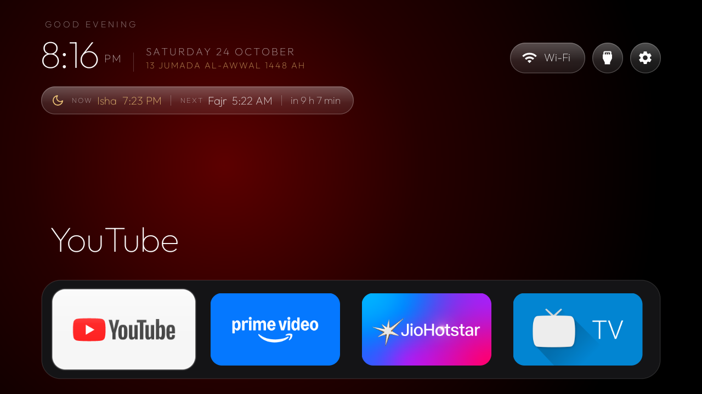
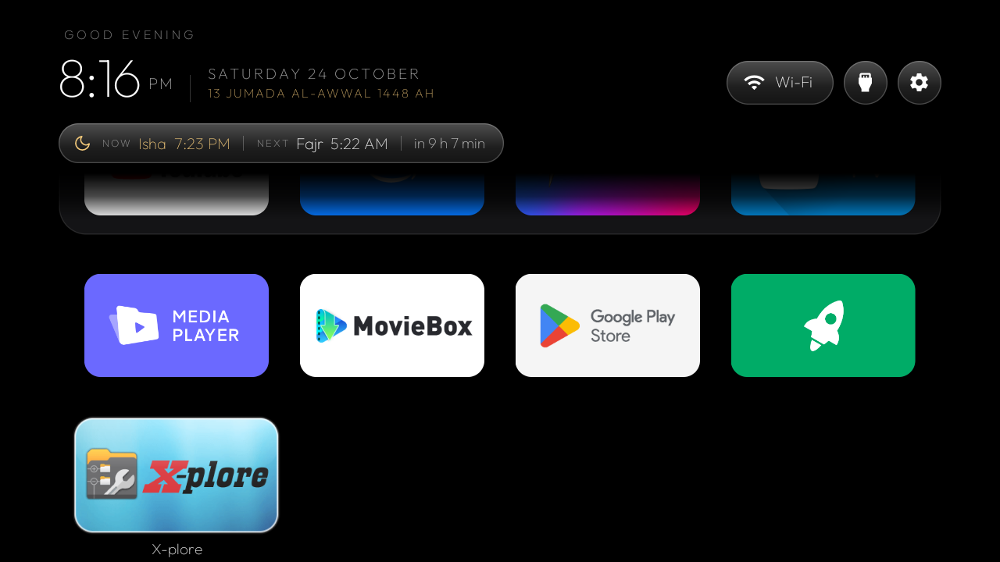
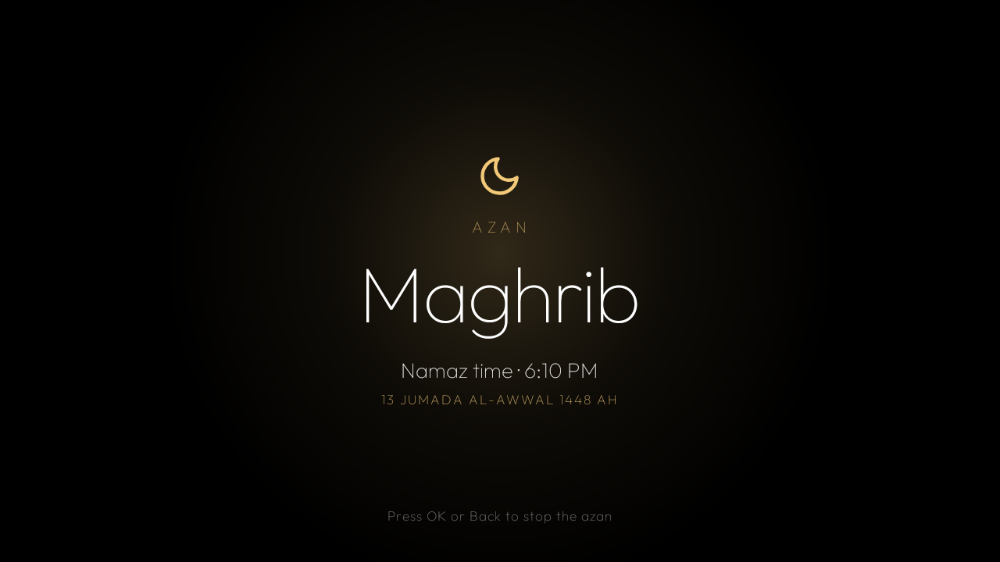

<h1 align="center">CleanXiaomiTV — Mi TV 4A</h1>

<p align="center">A debloated Xiaomi Mi TV 4A with a light, Apple TV–inspired home screen, namaz times and the azan.</p>



<table>
  <tr>
    <td width="50%"></td>
    <td width="50%"></td>
  </tr>
  <tr>
    <td align="center">All apps, four to a row</td>
    <td align="center">The azan screen at a namaz time</td>
  </tr>
</table>

## The TV

| | |
|---|---|
| TV | Xiaomi Mi TV 4A (firmware model `MiTV4I`, codename `magnolia`) |
| Firmware | Android TV 9 (SDK 28), build `PI.3698`, security patch 2022-01-05 |
| Hardware | Amlogic (`txl`), 32-bit ARM, about 1 GB RAM, 4.3 GB storage |
| Screen | 1280×720, 213 dpi |
| Inputs | HDMI 1–3, AV and the antenna tuner, through Android's TV input framework (`com.droidlogic.tvinput`) |
| Original Home | `com.google.android.tvlauncher/.MainActivity` |

Everything here was checked on this TV over ADB; another model or firmware may have other package names.

## What it does

- **Debloat** ([`debloat-mitv4a.txt`](debloat-mitv4a.txt)): 19 packages disabled for user 0, never uninstalled: Xiaomi
  analytics and Google feedback, PatchWall and the Xiaomi recommendation apps (Mi TV+, Mi Channel, OEM tab), Play
  auto-installs, Sensy, and preloaded apps that were not used. Chromecast, Miracast, firmware updates, Live TV,
  the inputs, the remote, Gboard and the Play Store stay as they were.
- **Home screen**: black, with the focused dock app's own colour as a soft glow; greeting, thin clock and date top
  left; Wi-Fi (the network's name), Inputs and Settings top right; a dock of YouTube, Prime Video, JioHotstar and
  Live TV; every other app in a four-column grid below it. One glass highlight moves between tiles.
- **Namaz**: the Islamic (Hijri) date under the date, and a pill with the current namaz and the next one with a
  countdown, for Mumbai (Karachi method, Hanafi Asr). From [Aladhan](https://aladhan.com), once a day.
- **Azan**: at Fajr, Dhuhr, Asr, Maghrib and Isha a full-screen azan screen opens over whatever is on and plays
  the azan from the Prophet's Mosque in Madinah. Other apps' sound pauses while it plays and comes back after it.
  OK or Back stops it. Nothing plays while the TV is in standby.
- **Inputs**: the Inputs pill lists HDMI 1–3, AV and Live TV from the TV itself and switches through Live TV.

## Prerequisites

On the TV: Settings → Device Preferences → About → press OK on **Build** seven times, then Developer options →
**USB debugging** on (network debugging on port 5555 is part of it on this firmware). The first connection shows
an "Allow USB debugging?" prompt on the TV with the computer's key fingerprint: check it and accept.

On a Windows computer on the same network: the Android SDK with `platform-tools`, `platforms;android-34` and
`build-tools;34.0.0` (Android Studio installs them), and a JDK 17 or newer (Android Studio's own works).

```powershell
adb connect <tv-ip>:5555        # Settings > Network on the TV shows its IP
$env:TV_SERIAL = '<tv-ip>:5555' # or pass -Serial to every script
```

## Install, step by step

```powershell
tools\backup.ps1                          # read-only snapshot into backups\ (stays out of git)
tools\disable.ps1 debloat-mitv4a.txt      # debloat, one package at a time, recorded in manifest\mi-tv-4a.json
launcher\build-and-install.ps1            # build, install and open the launcher (Home is not changed)
tools\set-home.ps1 -DisableStock -WifiName -LocationOn   # make it Home, show the Wi-Fi name
```

`set-home.ps1` options, each recorded so `restore.ps1` can undo it:

- `-DisableStock`: the stock launcher's HOME filter has priority 2, which an app cannot get, so it wins over any
  default. It is disabled; if Home still does not switch, it is enabled again straight away.
- `-WifiName`: location permission for the launcher; Android 9 shows the network name only to apps with it.
- `-LocationOn`: Android 9 also hides the name while Location is off. This TV has no network location provider, so
  this sets `location_mode` 3, as the Location switch in Settings does.

## Change the dock, the look or the namaz settings

Everything is in [`launcher/app/src/main/res/values/config.xml`](launcher/app/src/main/res/values/config.xml), then
`launcher\build-and-install.ps1`:

- `dock_apps`: the four dock apps, in order (package names; `adb shell pm list packages`). The order can also be
  changed on the TV: Settings pill → Dock apps and order, or hold OK on a dock tile to move it.
- `grid_columns`, `dock_opacity`, `advanced_effects`, `home_photo` (Bing photo of the day; off).
- `prayer_latitude` / `prayer_longitude`, `prayer_method` (1 Karachi), `prayer_school` (1 Hanafi), `hijri_date`,
  `hijri_adjustment` (−2 to 2 days, when the local moon sighting differs), `home_prayer`.
- `azan` and `azan_prayers` (any of fajr, dhuhr, asr, maghrib, isha). "Prayer times on Home" and "Azan at namaz
  times" are also switches in the Settings pill.

**Wallpaper** without rebuilding: put a `config.json` (same keys, see [`themes/README.md`](themes/README.md)) and a
`wallpaper.jpg` in a folder and run `tools\theme.ps1 <folder>`; `tools\theme.ps1 -Reset` removes it.

**Design**: layouts in `launcher/app/src/main/res/layout/` (`activity_main.xml` home, `activity_azan.xml` azan
screen), colours and sizes there and in `values/styles.xml`, behaviour in `launcher/app/src/main/java/com/gathin/tvhome/`.

## Undo

```powershell
tools\restore.ps1                      # everything this project changed, from manifest\mi-tv-4a.json
tools\restore.ps1 -UninstallLauncher   # the same, and remove the launcher
```

It re-enables every package the project disabled (packages that were already disabled before stay so), gives
Home back to `com.google.android.tvlauncher/.MainActivity`, revokes the location permission and turns Location off
again, but only for settings still at the value this project set. It reports anything it could not restore and can
be run more than once. To enable a single app by hand: `adb shell pm enable --user 0 <package>`.

## Changes on this TV ([`manifest/mi-tv-4a.json`](manifest/mi-tv-4a.json))

- **Disabled** (20): the 19 packages in `debloat-mitv4a.txt`, and the stock launcher `com.google.android.tvlauncher`.
- **Already disabled before the project, untouched**: `katniss` (Assistant), `backdrop`, `speech.pumpkin`,
  `tvrecommendations`, `leanbacklauncher.recommendations`, `tv.bugreportsender`, `mitv.gallery`, `xiaomi.statistic`,
  `xm.webcontent`.
- **Settings**: `secure/location_mode` (unset → 3) and `secure/location_providers_allowed` (empty → `gps`).
- **Permission**: `ACCESS_FINE_LOCATION` granted to the launcher.
- **Home**: the launcher set as the default Home activity.
- **Kept on purpose**: the setup wizard `com.google.android.tungsten.setupwraith` (it can stand in as Home if the
  launcher is ever removed). The factory test app `com.duokan.factorytest` does not exist on this firmware.

## Verification on the TV

All checked on the real TV with key events over ADB and screenshots taken on the TV:

| Check | Result |
|---|---|
| Home key from inside YouTube opens the launcher | ✅ |
| Header: greeting, clock, date, Islamic date; pills top right | ✅ |
| Left/Right in the dock and header follow the visual order; the edge pills stay put | ✅ |
| Down from the dock and grid moves one row, same column where there is one; scrolled rows fade under the header | ✅ |
| Up from the grid → dock → header | ✅ |
| Inputs pill: HDMI 1–3, AV, Live TV; Down moves one row; Back closes it, then stays on Home | ✅ |
| HDMI 1 from the Inputs pill opens it through Live TV | ✅ |
| Settings pill → Android Settings, and Back | ✅ |
| Opening Prime Video, coming back: focus on the same tile (also for grid tiles) | ✅ |
| Wi-Fi pill shows the network name | ✅ |
| Namaz pill and Islamic date match Aladhan for Mumbai (24 Oct 2026: Isha 19:23, Fajr 05:22, 13 Jumada al-Awwal 1448) | ✅ |
| Azan over a playing YouTube video: azan screen, YouTube stops, the azan plays; after OK YouTube plays again | ✅ |
| Azan alarm scheduled exactly (after Isha: the 00:01 refresh that schedules Fajr) | ✅ |

## Known limitations

- **Netflix** is not offered for this TV by the Play Store ("Your device isn't compatible") and was not installed.
- **The Input key**: this TV's remote has none; use the Inputs pill.
- **Azan over Live TV / HDMI**: covering Live TV stops its picture and sound while the azan plays; not yet tried
  with a device on HDMI. **In standby** the azan is skipped by design (not tested by putting the TV to sleep).
  The same recording plays at Fajr.
- **Fast key presses** while a menu is still opening can land on the wrong row; at normal remote speed it is exact.
- The Hijri date is Aladhan's calculated calendar; set `hijri_adjustment` if your local moon sighting differs.
- The macOS/Linux `.sh` scripts in `tools/` and `launcher/` are from the upstream project (another TV) and do not
  use the change manifest; on this TV use the PowerShell scripts.

## Network

No analytics and no accounts. The launcher talks to [Aladhan](https://aladhan.com) once a day (only Mumbai's
coordinates, the date, the method and the Asr school). Weather, photos of the day and the other upstream features
are off in `config.xml`.

## Credits

Built on [CleanXiaomiTV](https://github.com/majnioui/CleanXiaomiTV) and [CleanYourTV](https://github.com/Gathin23/cleanyourtv) by
Gathin. MIT licensed, see [`LICENSE`](LICENSE). Font: Outfit (OFL, `launcher/FONT-LICENSE-OFL.txt`). Icons: Material
(Apache 2.0), Feather (MIT), Lucide (ISC). Azan recording: "Call to prayer from the prophet's mosque" by ejaz215,
[Wikimedia Commons](https://commons.wikimedia.org/wiki/File:33937_ejaz215_call-to-prayer-from-the-prophet-s-mo.ogg),
CC BY 3.0 (see `launcher/AZAN-AUDIO-LICENSE.txt`).
